# SYSTEM ARCHITECTURE & ENGINEERING SPECIFICATION
## Wholesale / Ghalla Mandi Inventory, Commission & Double-Entry Accounting ERP
### Desktop (Electron) | Frontend (React + TS) | Backend (Node.js + Express) | Database (MySQL 8 + Prisma)

---

## 1. REQUIREMENTS ANALYSIS

### 1.1 Business Domain & Commodity Realities
The wholesale commodity trade (*Ghalla Mandi*) operates under strict physical and financial realities that differ fundamentally from standard retail or manufacturing:
1. **Commodities Handled:** Red Chilli (*Lal Mirch*), Coriander (*Dhania*), Turmeric (*Haldi*), Cumin (*Zeera*), Pulses, Grains, etc.
2. **Dual Ownership Model:**
   - **Own Stock:** Purchased on credit/cash. Held on the balance sheet as an inventory asset. Sold to earn trading margin (Gross Revenue - Cost of Goods Sold). FIFO valuation is mandatory.
   - **Consignment / Commission Stock:** Physical custody without title ownership. The goods belong entirely to the supplying farmer or trader (*Kissan / Bepari*). Sold on their behalf to wholesale buyers. The shop earns an agreed percentage commission. The net proceeds (Gross Sale - Commission - Deductions) are a direct liability payable to the supplier.
   - **Zero Cross-Contamination:** Consignment stock must never be included in shop assets, valuation, or COGS. Consignment sales must never be recorded as shop trading revenue.
3. **Packaging & Unit Conversions:**
   - Units: *Mann* (traditional weight, typically ~40 KG or custom regional benchmark), *KG*, *Bags* (*Bora / Bori*).
   - Non-standard packaging: A bag of Red Chilli might weigh 35 KG, while a bag of Turmeric might weigh 50 KG, and Coriander might weigh 40 KG. Universal conversions do not exist; conversions must be configured item by item, with transaction-level snapshotting to preserve historical integrity.
4. **Commission Mechanics:** Strictly percentage-based. Determined per supplier, with optional item-specific overrides and effective date ranges. Snapshotted immutably on each sale line.
5. **Single Owner Security Model:** Exactly one owner administrative credential. No multi-tier employee logins or role matrix. LAN client workstations authenticate via registered device identities without creating human employee accounts.
6. **Operating Environment:** Offline-first shop LAN where the primary workstation acts as the on-premises database and API server. Cloud sync operates asynchronously for off-site reporting, backup, and mobile monitoring without compromising local uptime.

---

## 2. SYSTEM ARCHITECTURE

```
+----------------------------------------------------------------------------------------------------+
|                                    MAIN WORKSTATION (SHOP SERVER)                                  |
|                                                                                                    |
|  +----------------------------+     IPC Bridge      +-------------------------------------------+  |
|  |     Electron Renderer      | <=================> |             Electron Main Process         |  |
|  |  (React 18 + TS + Vite UI) |  (contextBridge)    |  - Lifecycle, Tray, Safe Shell, Auto-Start|  |
|  +----------------------------+                     +-------------------------------------------+  |
|                |                                                          |                        |
|                | HTTP / REST (localhost)                                  | Spawns / Monitors      |
|                v                                                          v                        |
|  +----------------------------------------------------------------------------------------------+  |
|  |                         LOCAL EMBEDDED NODE.JS / EXPRESS API SERVER                          |  |
|  |  - Auth Middleware (Single Owner + Device Token)   - Accounting Engine (Auto-Journals)       |  |
|  |  - FIFO Stock Allocation Engine (Mutex/Row-Locks)  - Commission Engine (Snapshots)           |  |
|  |  - Decimal.js Arithmetic Layer                     - Outbox Sync Worker (Background Worker)  |  |
|  +----------------------------------------------------------------------------------------------+  |
|                |                                                          |                        |
|                v Prisma ORM 5/6                                           | Background Job         |
|  +-------------------------------------+                +---------------------------------------+  |
|  |     LOCAL MYSQL 8 DATABASE          |                |      LOCAL BACKUP SERVICE (mysqldump) |  |
|  |  - InnoDB, Row-level Locking        |                |  - Automated Daily Snapshots          |  |
|  |  - Strict Foreign Keys & ACID       |                |  - Verifiable Checksum Archives       |  |
|  +-------------------------------------+                +---------------------------------------+  |
+----------------------------------------------------------------------------------------------------+
       ^                                                                |
       | LAN HTTP/REST (Port 4000)                                      | HTTPS Outbound (Sync API)
       | (Device Authenticated)                                         v
+-------------------------------+                         +------------------------------------------+
|      LAN CLIENT WORKSTATIONS  |                         |               CLOUD SERVER               |
|  - Electron Client App        |                         |  - Node.js Cloud Sync API                |
|  - Connects to Main Shop IP   |                         |  - Cloud MySQL 8 Mirror Database         |
|  - No local DB instance       |                         |  - Remote Web Reporting Dashboard        |
+-------------------------------+                         |  - Cloud Backup & Disaster Recovery Vault|
                                                          +------------------------------------------+
```

### 2.1 Technology Stack
- **Desktop Host:** Electron 30+ (Node Integration: `false`, Context Isolation: `true`, Sandbox: `true`).
- **UI Tier:** React 18, TypeScript 5, Vite, Tailwind CSS, Lucide Icons, Radix UI primitives.
- **Client State & API:** TanStack React Query v5 (caching, optimistic mutations, offline tracking), Zustand (UI state).
- **Local Application Server:** Node.js 20 LTS, Express, Prisma ORM.
- **Calculation Precision:** `decimal.js` for all financial (19,4), quantity (19,6), conversion (19,8), and rate math.
- **Database:** MySQL 8 Community Edition (InnoDB engine, strict mode `STRICT_TRANS_TABLES`, UTF8mb4).
- **Inter-Process Security:** Preload script exposing typed channels via `contextBridge.exposeInMainWorld('electronAPI', ...)`.

---

## 3. ARCHITECTURE DIAGRAM

```mermaid
flowchart TD
    subgraph Main_Desktop["Main Shop Workstation (Primary Node)"]
        UI["React Desktop UI (Electron Renderer)"]
        Preload["Secure Preload Bridge (contextBridge)"]
        MainProc["Electron Main Host"]
        API["Node.js / Express API Server (:4000)"]
        DB[("Local MySQL 8 Database (InnoDB)")]
        SyncWorker["Outbox Sync Daemon"]
        BackupWorker["Automated Backup Daemon"]
        
        UI -->|IPC / HTTP| Preload
        Preload --> API
        MainProc -->|Lifecycle & Process Supervision| API
        API -->|Prisma Client (ACID Transactions)| DB
        SyncWorker -->|Read Outbox / Mark Synced| DB
        BackupWorker -->|mysqldump / archive| DB
    end

    subgraph LAN_Clients["Shop LAN Nodes (Billing Counters)"]
        ClientUI["React Desktop UI (Client Mode)"]
        ClientPreload["Client Preload Bridge"]
        ClientUI -->|HTTP / REST (LAN Port 4000)| API
    end

    subgraph Cloud_Infrastructure["Cloud Remote & Sync Infrastructure"]
        CloudAPI["Cloud Sync API (Node.js/Express)"]
        CloudDB[("Cloud MySQL 8 Database")]
        CloudDashboard["Remote Reporting Portal"]
        CloudVault["Cloud S3/Encrypted Backup Vault"]
        
        SyncWorker -->|HTTPS POST Outbox Events| CloudAPI
        CloudAPI -->|Idempotent Ingestion| CloudDB
        CloudDashboard -->|Read-Only Queries| CloudDB
        BackupWorker -->|Encrypted Archive Upload| CloudVault
    end
```

---

## 4. COMPLETE DATABASE ER DIAGRAM

```mermaid
erDiagram
    BUSINESS_PROFILE ||--o{ APP_SETTINGS : configures
    APP_SETTINGS ||--o{ FINANCIAL_YEARS : defines
    FINANCIAL_YEARS ||--o{ ACCOUNTING_PERIODS : contains

    ITEM_CATEGORIES ||--o{ ITEMS : categorizes
    UNITS ||--o{ ITEMS : provides_base_unit
    ITEMS ||--o{ ITEM_UNIT_CONVERSIONS : has_multi_units
    UNITS ||--o{ ITEM_UNIT_CONVERSIONS : target_unit

    SUPPLIERS ||--o{ COMMISSION_AGREEMENTS : binds
    ITEMS ||--o{ COMMISSION_AGREEMENTS : optional_item_override

    SUPPLIERS ||--o{ OPENING_STOCK_ENTRIES : referenced_in_consignment
    ITEMS ||--o{ OPENING_STOCK_ITEMS : specified_in
    OPENING_STOCK_ENTRIES ||--o{ OPENING_STOCK_ITEMS : includes

    SUPPLIERS ||--o{ PURCHASE_INVOICES : bills_from
    PURCHASE_INVOICES ||--o{ PURCHASE_INVOICE_ITEMS : contains
    ITEMS ||--o{ PURCHASE_INVOICE_ITEMS : items_purchased

    SUPPLIERS ||--o{ CONSIGNMENT_RECEIPTS : delivered_by
    CONSIGNMENT_RECEIPTS ||--o{ CONSIGNMENT_RECEIPT_ITEMS : contains
    ITEMS ||--o{ CONSIGNMENT_RECEIPT_ITEMS : received_items

    ITEMS ||--o{ STOCK_BATCHES : tracks_lots
    SUPPLIERS ||--o{ STOCK_BATCHES : owns_consignment_lot
    STOCK_BATCHES ||--o{ STOCK_MOVEMENTS : logs_history
    STOCK_BATCHES ||--o{ STOCK_ALLOCATIONS : satisfies_sales

    CUSTOMERS ||--o{ SALES_INVOICES : sold_to
    SALES_INVOICES ||--o{ SALES_INVOICE_ITEMS : contains
    ITEMS ||--o{ SALES_INVOICE_ITEMS : sold_item
    SALES_INVOICE_ITEMS ||--o{ STOCK_ALLOCATIONS : draws_from

    SALES_INVOICES ||--o{ SALES_RETURNS : returns_against
    SALES_RETURNS ||--o{ SALES_RETURN_ITEMS : contains

    SUPPLIERS ||--o{ SUPPLIER_SETTLEMENTS : settled_with
    SUPPLIER_SETTLEMENTS ||--o{ SUPPLIER_SETTLEMENT_ITEMS : pays_lines
    SUPPLIERS ||--o{ SUPPLIER_ADVANCES : paid_to
    SUPPLIER_ADVANCES ||--o{ SUPPLIER_ADVANCE_ALLOCATIONS : applied_against

    CHART_OF_ACCOUNTS ||--o{ JOURNAL_ENTRY_LINES : categorizes
    JOURNAL_ENTRIES ||--o{ JOURNAL_ENTRY_LINES : balances
    CASH_BANK_ACCOUNTS ||--o{ RECEIPT_VOUCHERS : deposited_into
    CASH_BANK_ACCOUNTS ||--o{ PAYMENT_VOUCHERS : paid_from

    SYNC_DEVICES ||--o{ SYNC_OUTBOX : originated_from
    SYNC_OUTBOX ||--o{ SYNC_LOGS : logged_in
```



---

## 5. COMPLETE DATABASE TABLE LIST

| # | Domain | Table Name | Purpose |
|---|--------|------------|---------|
| 1 | System | `business_profile` | Business legal details, NTN, shop location, contact numbers |
| 2 | System | `app_settings` | Base unit default, currency, strict FIFO lock timeout, sync flags |
| 3 | System | `owner_auth` | Single owner credentials (Argon2id hash), master PIN, salt |
| 4 | System | `registered_devices` | LAN workstations hardware ID, device token, authorized status |
| 5 | Master | `financial_years` | Fiscal year bounds, opening and closing dates, lock status |
| 6 | Master | `accounting_periods` | Monthly/quarterly periods, soft and hard close statuses |
| 7 | Master | `document_sequences` | Atomically incremented document numbers (PUR-YYYY-XXXX, etc.) |
| 8 | Master | `units` | Primary unit dictionary: KG, Mann, Bag, Gram, Metric Ton |
| 9 | Master | `item_categories` | Commodity groupings (Spices, Grains, Oilseeds, Pulses) |
| 10| Master | `items` | Core commodity master (name, code, category, base unit, min stock) |
| 11| Master | `item_unit_conversions` | Item-specific conversion ratio to base KG (e.g. 1 Bag Chilli = 38 KG) |
| 12| Master | `customers` | Wholesale buyer profiles, phone, address, credit limit, status |
| 13| Master | `suppliers` | Consignment suppliers and direct vendors (*Bepari / Kissan*) |
| 14| Master | `employees` | Business employee records (salary, joining date, contact - NO logins) |
| 15| Opening| `opening_stock_entries`| Opening balance batch master, reference date, owner signoff |
| 16| Opening| `opening_stock_items`  | Detailed item lines (own vs. consignment, valuation, quantities) |
| 17| Inventory| `stock_batches`     | Core FIFO batch record: item, owner type, supplier, remaining qty, unit cost |
| 18| Inventory| `stock_movements`   | Immutable ledger of every physical inflow/outflow transaction |
| 19| Inventory| `stock_allocations` | Bridge between sale lines and exact batch deductions |
| 20| Inventory| `stock_adjustments` | Stock audit reconciliation header (damage, shortage, count corrections) |
| 21| Inventory| `stock_adjustment_items`| Individual line adjustments with responsibility assignment |
| 22| Purchase | `purchase_invoices` | Header for own-stock purchase invoices from suppliers |
| 23| Purchase | `purchase_invoice_items`| Line items, quantities, rates, discounts, allocated landed costs |
| 24| Purchase | `purchase_returns`  | Header for own-stock goods returned to vendor |
| 25| Purchase | `purchase_return_items`| Returned lines linked to original purchase batch |
| 26| Commission| `commission_agreements`| Supplier percentage commission rules + item overrides + effective dates |
| 27| Commission| `consignment_receipts`| Inward gate pass / receipt of supplier-owned goods |
| 28| Commission| `consignment_receipt_items`| Consignment goods line items, packaging, gross/net weight |
| 29| Commission| `consignment_returns`| Header for returning unsold consignment goods to supplier |
| 30| Commission| `consignment_return_items`| Return item lines linked to original consignment batch |
| 31| Commission| `supplier_advances` | Cash/bank advance payments made to consignment suppliers |
| 32| Commission| `supplier_settlements`| Payout settlement against net payable from realized sales |
| 33| Commission| `supplier_settlement_items`| Line-by-line settlement allocations |
| 34| Sale     | `sales_invoices`    | Header for common sale invoice (Cash, Credit, Partial) |
| 35| Sale     | `sales_invoice_items`| Sale lines capturing item, unit, rate, ownership, commission snapshot |
| 36| Sale     | `sales_returns`     | Customer sales return header |
| 37| Sale     | `sales_return_items`| Returned lines with saleable/damaged condition flag |
| 38| Accounts | `chart_of_accounts` | Parent-child general ledger account tree |
| 39| Accounts | `journal_entries`   | Header for all double-entry journal vouchers |
| 40| Accounts | `journal_entry_lines`| Debits and credits with currency precision and party links |
| 41| Cash/Bank| `cash_bank_accounts`| Master for shop cash tills and bank checking accounts |
| 42| Cash/Bank| `receipt_vouchers`  | Official cash/bank inward receipt vouchers |
| 43| Cash/Bank| `payment_vouchers`  | Official cash/bank outward payment vouchers |
| 44| Sync     | `sync_outbox`       | Outbound event queue for local-to-cloud transactional sync |
| 45| Sync     | `sync_inbox`        | Inbound event queue for cloud-to-local acknowledgments |
| 46| Sync     | `sync_logs`         | Sync execution audit trail, latencies, payloads, and errors |
| 47| Sync     | `sync_conflicts`    | Quarantined records requiring administrative resolution |
| 48| Audit    | `audit_logs`        | Immutable user action log (IP, device, before/after JSON diff) |

---

## 6. TABLE RELATIONSHIPS AND FOREIGN KEYS

All tables use `BIGINT UNSIGNED AUTO_INCREMENT` for high-throughput relational indexing and `CHAR(36)` (UUID v4) for cross-node synchronization idempotency.

### Key Foreign Key Policies:
1. **Critical Financial & Stock Tables:** `ON DELETE RESTRICT` and `ON UPDATE CASCADE`.
   - Never allow cascading deletions on `stock_batches`, `stock_movements`, `purchase_invoices`, `sales_invoices`, `journal_entries`, or `commission_agreements`.
2. **Dependent Line Items:** `ON DELETE CASCADE` only during draft invoice editing prior to posting; once posted, lines become immutable.
3. **Master Reference Data:** `ON DELETE RESTRICT` on `items`, `units`, `customers`, and `suppliers` if any transactional records reference them.

---

## 7. INVENTORY LIFECYCLE

```
[ PHYSICAL INWARD ]
        |
        +---> [ OWN STOCK PATH ]
        |           |
        |           +---> 1. Opening Stock Entry (Opening Balance Equity)
        |           +---> 2. Own Purchase Invoice (Landed Cost allocated to Unit Cost)
        |           |
        |           v
        |     CREATE STOCK BATCH:
        |     - Ownership: OWN
        |     - Unit Cost: Landed FIFO Cost
        |     - Initial Qty = Remaining Qty
        |     - State: ACTIVE
        |
        +---> [ CONSIGNMENT / COMMISSION PATH ]
                    |
                    +---> 1. Consignment Opening Stock (Supplier Reference)
                    +---> 2. Consignment Receipt (Gate Inward, Commission Agreement Bound)
                    |
                    v
              CREATE STOCK BATCH:
              - Ownership: CONSIGNMENT
              - Supplier ID: Bound to Bepari
              - Unit Cost: 0.0000 (No shop inventory asset recognized)
              - Initial Qty = Remaining Qty
              - State: ACTIVE

[ PHYSICAL OUTWARD / DISPATCH ]
        |
        +---> [ SALE TRANSACTION ]
        |           |
        |           +---> User selects Ownership Mode (OWN or CONSIGNMENT + Supplier)
        |           +---> System queries eligible active batches (FIFO order)
        |           +---> Allocates oldest available batches transactionally (Row Locks)
        |           +---> Generates Stock Allocations & Stock Movements
        |           |
        |           +---> IF OWN:
        |           |       - Batch Remaining Qty decremented
        |           |       - COGS calculated = Sum(Allocated Qty * Batch Unit Cost)
        |           |       - Decreases Own Inventory Asset
        |           |
        |           +---> IF CONSIGNMENT:
        |                   - Supplier-specific Batch Remaining Qty decremented
        |                   - COGS = 0 (Shop bears no inventory cost)
        |                   - Commission Income & Supplier Payable recorded
        |
        +---> [ RETURNS & ADJUSTMENTS ]
                    |
                    +---> Purchase Return Out: Decrements specific purchase batch; decreases AP.
                    +---> Customer Return In: Restores original batch if saleable; reverses journals.
                    +---> Consignment Return Out: Decrements supplier batch; reduces consignment custody.
                    +---> Damage / Shortage: Quarantines stock with responsible party assigned.
```

---

## 8. FIFO ALLOCATION ALGORITHM

To prevent race conditions on concurrent LAN workstations, stock allocation executes inside an atomic database transaction with `SELECT ... FOR UPDATE` row-level locks.

### Algorithmic Steps:
1. **Input Parameters:** `itemId`, `ownershipType` (`OWN` | `CONSIGNMENT`), `supplierId` (required if `CONSIGNMENT`), `requestedBaseQty` (Decimal in KG).
2. **Transaction Scope:** Start SQL transaction with isolation level `READ COMMITTED` or `REPEATABLE READ`.
3. **Query Active Batches:**
   ```sql
   SELECT id, uuid, batch_number, remaining_base_qty, unit_cost
   FROM stock_batches
   WHERE item_id = :itemId
     AND ownership_type = :ownershipType
     AND (:ownershipType = 'OWN' OR supplier_id = :supplierId)
     AND remaining_base_qty > 0
     AND status = 'ACTIVE'
   ORDER BY received_date ASC, id ASC
   FOR UPDATE;
   ```
4. **Availability Verification:**
   - Sum `totalAvailableBaseQty = Sum(remaining_base_qty)`.
   - If `totalAvailableBaseQty < requestedBaseQty`:
     - **ABORT TRANSACTION.**
     - Throw error: `INSUFFICIENT_STOCK: Requested ${requestedBaseQty} KG, but only ${totalAvailableBaseQty} KG is available for item ${itemId} under ownership ${ownershipType}.`
5. **Deterministic Allocation Loop:**
   - Initialize `qtyRemainingToAllocate = requestedBaseQty`.
   - Initialize `allocations = []`.
   - For each locked batch in sorted order:
     - If `batch.remaining_base_qty <= qtyRemainingToAllocate`:
       - `takeQty = batch.remaining_base_qty`.
       - `batch.remaining_base_qty = 0`.
       - `batch.status = 'EXHAUSTED'`.
     - Else:
       - `takeQty = qtyRemainingToAllocate`.
       - `batch.remaining_base_qty = batch.remaining_base_qty - takeQty`.
     - `qtyRemainingToAllocate = qtyRemainingToAllocate - takeQty`.
     - `allocations.push({ batchId: batch.id, allocatedQty: takeQty, unitCost: batch.unitCost })`.
     - Update batch in database:
       ```sql
       UPDATE stock_batches
       SET remaining_base_qty = :newRemaining, status = :newStatus
       WHERE id = :batchId;
       ```
     - If `qtyRemainingToAllocate == 0`, break.
6. **Immutable Ledger Creation:**
   - Insert records into `stock_allocations` referencing the sale invoice item.
   - Insert records into `stock_movements` with `movement_type = 'SALE_OUT'`.
7. **Cost Output:**
   - For `OWN`: `totalCogs = Sum(alloc.allocatedQty * alloc.unitCost)`.
   - For `CONSIGNMENT`: `totalCogs = 0.00`.

---

## 9. UNIT CONVERSION DESIGN

### 9.1 Rules
- **Base Unit:** Standardized internally as **Kilogram (KG)** (`base_unit_id`).
- **Configurable Secondary Units:**
  - `Mann`: Defined per item or global default (e.g. 1 Mann = 40.000000 KG or 50.000000 KG).
  - `Bag` (*Bora*): Must be configured per commodity. A bag of whole dried chilli has low density (~30–38 KG), while coriander is ~40 KG and turmeric is ~50 KG.
- **Precision:** `DECIMAL(19, 8)` for conversion multipliers; `DECIMAL(19, 6)` for quantities.

### 9.2 Transaction Snapshot Pattern
Whenever any stock movement, purchase line, or sale line is posted, the software must never store just `entered_unit_id` and rely on a live lookup. The software records:
1. `entered_quantity`: The number typed by the user (e.g. `10.000000`).
2. `entered_unit_name`: Human-readable unit at that time (e.g. `"Bag (Chilli)"`).
3. `conversion_factor_snapshot`: Exact multiplier to base KG (e.g. `38.00000000`).
4. `base_quantity`: Calculated as `entered_quantity * conversion_factor_snapshot` (e.g. `380.000000 KG`).
5. `base_unit_name`: Standardized (`"KG"`).

*Result:* If the merchant later reconfigures Chilli Bags to weigh 40 KG in Settings, historical invoices and batch ledgers remain at 38 KG, ensuring zero retroactive balance distortion.

---

## 10. OWN-STOCK ACCOUNTING WORKFLOW

```
1. CASH PURCHASE:
   Debit:   1040 - Inventory Asset (Landed Cost: Goods + Freight + Loading)
   Credit:  1010 - Cash / Bank Account

2. CREDIT PURCHASE:
   Debit:   1040 - Inventory Asset (Landed Cost)
   Credit:  2010 - Accounts Payable: Own Suppliers

3. CREDIT SALE:
   Debit:   1020 - Accounts Receivable: Customer
   Credit:  4010 - Own Sales Revenue
   AND SIMULTANEOUS COGS ENTRY (FIFO Calculated):
   Debit:   5010 - Cost of Goods Sold (COGS)
   Credit:  1040 - Inventory Asset

4. CUSTOMER RECEIPT:
   Debit:   1010 - Cash / Bank Account
   Credit:  1020 - Accounts Receivable: Customer

5. SUPPLIER PAYMENT:
   Debit:   2010 - Accounts Payable: Own Suppliers
   Credit:  1010 - Cash / Bank Account

6. PURCHASE RETURN:
   Debit:   2010 - Accounts Payable: Own Suppliers
   Credit:  1040 - Inventory Asset
```

---

## 11. COMMISSION-STOCK ACCOUNTING WORKFLOW

Consignment transactions never affect the shop's trading sales revenue, inventory asset, or COGS.

```
1. CONSIGNMENT RECEIPT (100 Bags Coriander from Bepari X):
   - NO FINANCIAL JOURNAL ENTRY.
   - Custody Batch Created with zero inventory asset value.

2. COMMISSION SALE (Sale to Customer Y for Gross Rs. 500,000, Agreed 2% Commission):
   - Gross Sale Value = Rs. 500,000.00
   - Commission Earned (2%) = Rs. 10,000.00
   - Net Payable to Supplier = Rs. 490,000.00
   
   JOURNAL ENTRY:
   Debit:   1020 - Accounts Receivable: Customer     Rs. 500,000.00
   Credit:  2020 - Commission Supplier Payable (X)   Rs. 490,000.00
   Credit:  4020 - Commission Income                  Rs.  10,000.00
   
   (Notice: ZERO entry to Inventory Asset 1040 or COGS 5010)

3. CUSTOMER SETTLEMENT (Customer pays cash):
   Debit:   1010 - Cash in Till                       Rs. 500,000.00
   Credit:  1020 - Accounts Receivable: Customer     Rs. 500,000.00

4. SUPPLIER PAYOUT SETTLEMENT (Paying Bepari X):
   Debit:   2020 - Commission Supplier Payable (X)   Rs. 490,000.00
   Credit:  1010 - Bank Account                       Rs. 490,000.00
```

---

## 12. PERCENTAGE COMMISSION CALCULATION

### 12.1 Agreement Hierarchy
When a commission sale line is formed:
1. Check for specific active agreement for `(SupplierId, ItemId)` where `Date BETWEEN start_date AND end_date`.
2. If none, check for general supplier agreement for `SupplierId` with `ItemId IS NULL`.
3. If none, fall back to Default System Commission % in `app_settings` (configurable, default 2.000000%).

### 12.2 Exact Mathematics
$$\text{Gross Line Amount} = \text{Sold Base Qty} \times \text{Sale Rate per Base Unit} - \text{Line Discount}$$
$$\text{Commission Rate} = \text{Snapshotted Agreement Percentage}$$
$$\text{Commission Amount} = \text{ROUND}(\text{Gross Line Amount} \times \frac{\text{Commission Rate}}{100}, 4)$$
$$\text{Net Supplier Payable} = \text{Gross Line Amount} - \text{Commission Amount}$$

### 12.3 Customer Return on Commission Goods
If a customer returns 10 Bags out of a 50 Bag commission sale:
- Returned Gross Amount is credited back to customer receivable.
- Proportional Commission is reversed from Commission Income.
- Net reduction is debited from Supplier Payable.
- If goods are saleable, physical consignment batch remaining quantity is restored. If damaged, quarantined to shortage batch.

---

## 13. CUSTOMER AND SUPPLIER LEDGER DESIGN

To prevent financial confusion, supplier liabilities are split into separate subledgers:
1. **Accounts Payable (Own Purchases):** Arises from purchase invoices. Relieved by direct vendor payments.
2. **Consignment Payable (Commission Realizations):** Arises from commission sales of supplier-owned stock. Relieved by supplier settlements or advance allocations.
3. **Supplier Advances:** Asset account tracking pre-payments or advances given to farmers before crop arrival.

```
Customer Statement Formula:
Closing Receivable = Opening Balance + Own Stock Sales + Commission Sales - Cash/Bank Receipts - Sales Returns +/- Approved Adjustments

Supplier Statement Formula (Consignment):
Closing Payable = Opening Consignment Balance + Net Realized Consignment Proceeds (Gross Sales - Commission) - Commission Deductions - Supplier Cash Settlements - Advance Allocations +/- Approved Adjustments
```

---

## 14. ACCOUNTING POSTING RULES MATRIX

| Transaction Type | Debit Account | Credit Account | Value Basis |
|------------------|---------------|----------------|-------------|
| Opening Own Stock | 1040 - Own Inventory Asset | 3020 - Opening Balance Equity | Landed Opening Value |
| Opening Customer Bal | 1020 - Accounts Receivable | 3020 - Opening Balance Equity | Verified Opening Bal |
| Opening Supplier Bal (Own) | 3020 - Opening Balance Equity | 2010 - Accounts Payable (Own) | Verified Opening Bal |
| Opening Consignment Bal | 3020 - Opening Balance Equity | 2020 - Commission Supplier Pay | Verified Net Payable |
| Own Stock Purchase (Credit)| 1040 - Own Inventory Asset | 2010 - Accounts Payable (Own) | Net Landed Invoice Amt |
| Own Stock Purchase (Cash)  | 1040 - Own Inventory Asset | 1010 - Cash / Bank Account | Net Landed Invoice Amt |
| Landed Freight / Loading   | 1040 - Own Inventory Asset | 1010 - Cash / Bank or 2030 AP | Allocated Expense Amt |
| Own Stock Sale (Credit)    | 1020 - Accounts Receivable | 4010 - Own Sales Revenue | Invoice Gross - Discount |
| Own Stock Sale (FIFO COGS) | 5010 - Cost of Goods Sold | 1040 - Own Inventory Asset | Exact FIFO Batch Cost |
| Commission Stock Sale      | 1020 - Accounts Receivable | 2020 - Commission Payable (Net)<br>4020 - Commission Income | Gross = Net + Commission |
| Customer Receipt           | 1010 - Cash / Bank Account | 1020 - Accounts Receivable | Actual Received Cash/Bank |
| Supplier Settlement (Comm) | 2020 - Commission Payable | 1010 - Cash / Bank Account | Settlement Payout Amt |
| Supplier Advance           | 1050 - Supplier Advances | 1010 - Cash / Bank Account | Cash/Bank Advance Payout |
| Advance to Settlement Alloc| 2020 - Commission Payable | 1050 - Supplier Advances | Cleared Advance Amt |
| Operating Expense (Rent/Sal)| 5020 - Operating Expenses | 1010 - Cash / Bank Account | Voucher Payout Amt |

---

## 15. LAN & CLOUD SYNCHRONIZATION ARCHITECTURE

### 15.1 Transactional Outbox Pattern
To guarantee zero transaction loss during local operations:
1. Every business transaction (e.g. posting a sale) writes to business tables (`sales_invoices`, `stock_movements`, `journal_entries`) AND inserts an event record into `sync_outbox` inside the **same atomic database transaction**.
2. If MySQL commits, the event is guaranteed to be queued locally.

```sql
INSERT INTO sync_outbox (uuid, aggregate_type, aggregate_id, event_type, payload_json, status, created_at)
VALUES (UUID(), 'SALE_INVOICE', :invoiceId, 'SALE_POSTED', :jsonString, 'PENDING', NOW());
```

### 15.2 Sync Daemon Workflow
- A background worker polls `sync_outbox WHERE status = 'PENDING' ORDER BY id ASC LIMIT 50`.
- Packages the batch with local sequence number and cryptographic signature.
- Submits via HTTPS POST to Cloud Server `/api/v1/sync/push`.
- **Cloud Processing:**
  - Authenticates shop device certificate/token.
  - Checks `idempotency_key` against Cloud `sync_inbox`.
  - Appends to Cloud database replica in order.
  - Returns `HTTP 200 { acknowledgedUuids: [...] }`.
- **Local Acknowledgment:**
  - Upon receiving HTTP 200, local worker marks events as `ACKNOWLEDGED`.
  - Events are NEVER marked synced before remote server confirmation.

---

## 16. OFFLINE CONFLICT STRATEGY

### 16.1 Authoritative Master Strategy
Physical commodities inside a Ghalla Mandi shop exist in a single location. Therefore:
- The **Main Local Shop Server is the sole authoritative master** for all inventory stock deductions and allocation.
- LAN client workstations connect directly to the Main Local Server API. If the shop loses internet connection to the cloud, **the shop continues operating at 100% speed** because the database is local.
- If a remote cloud user attempts to sell stock while disconnected from the main shop server, the action is **BLOCKED**. Remote cloud access is designated as **Read-Only / Reporting / Remote Administration**.
- Stock allocation cannot be partitioned across disparate offline databases without risking selling the same bag of red chilli twice.

---

## 17. BACKUP AND RECOVERY STRATEGY

1. **Automated Daily Local Dump:**
   - Background worker invokes `mysqldump --single-transaction --quick --lock-tables=false` at midnight or application close.
   - Compresses dump with gzip and computes SHA-256 hash.
   - Rotates local archives: Keeps daily backups for 30 days, monthly for 12 months.
2. **Encrypted Cloud Mirror:**
   - Compressed archive is uploaded to encrypted cloud storage after generation.
3. **Restoration Verification Test:**
   - Dedicated CLI tool (`npm run db:verify-backup <filepath>`) spins up a temporary MySQL test container, restores the dump, and verifies row counts and Trial Balance reconciliation.
4. **Zero Overwrite Protection:**
   - New backups never overwrite previous archives; filenames are timestamped (`backup_YYYYMMDD_HHMMSS.sql.gz`).

---

## 18. DEVELOPMENT PHASE PLAN

- **Phase 1: Architecture, Schemas & System Foundations**
  - Finalize Prisma schema, migrations, decimal utilities, seed data, and system structure.
- **Phase 2: Project Shell & Single-Owner Authentication**
  - Electron + React + Node setup, secure preload bridge, Argon2id auth, device registration, main desktop shell.
- **Phase 3: Item Master, Units & Inventory Engine**
  - Item Master, unit conversion, opening stock, FIFO batch allocation engine, stock ledger, stock adjustments.
- **Phase 4: Customer, Supplier & Sales Foundation**
  - Customer and supplier registries, own-stock purchases, common sale interface, partial payments, credit limits.
- **Phase 5: Commission Management Module**
  - Commission agreements, consignment receipt, supplier-isolated batches, commission sales, settlements, advances, returns.
- **Phase 6: Full Double-Entry Accounting System**
  - Chart of accounts, automated journal posting engine, general ledger, trial balance, P&L, balance sheet.
- **Phase 7: Reports, Vouchers & Dashboard**
  - Real-time business dashboard, cash/bank vouchers, stock reports, commission reports, employee records.
- **Phase 8: LAN Connectivity, Sync & Backup Engine**
  - LAN server binding, client device pairing, transactional outbox sync, automated backups.
- **Phase 9: Quality Assurance, E2E Testing & Windows Installer**
  - Automated tests (FIFO, stock integrity, accounting balance), stress testing, Electron Windows installer (`.exe`).

---

## 19. RISKS AND UNRESOLVED BUSINESS DECISIONS

The following business parameters must remain fully configurable in Settings or confirmed by the business owner before setting default operational values:

1. **Local Weight Standards:**
   - Standard *Mann* in Pakistan/India wholesale markets is typically 40 KG, but some grain commodities trade at 50 KG, 100 KG, or 40.5 KG (*Kacha/Pucca Mann*). *System implementation: Configurable multiplier per item; default 40.000000 KG.*
2. **Bag Tare & Packaging Deductions:**
   - In Mandi operations, buyers often deduct empty bag weight (e.g. 1 KG per jute bag, 0.5 KG per polypropylene bag). *System implementation: Support gross weight, tare deduction, and net chargeable weight.*
3. **Consignment Settlement Policy:**
   - When does the commission supplier become eligible for payment?
     - Option A: Immediately upon sale (shop carries credit risk of customer).
     - Option B: Only after cash is collected from customer (recommended wholesale standard).
     - *System implementation: Configurable switch in Commission Settings.*
4. **Market Cess & Mandi Tax:**
   - Certain Mandi committees levy 1% to 2% market committee fee (*Chungi / Market Tax*). *System implementation: Configurable tax/fee line on sales and purchases.*
5. **Initial Chart of Accounts & Opening Balances:**
   - Opening cash, bank accounts, and customer balances must be provided by the owner during initial setup.
